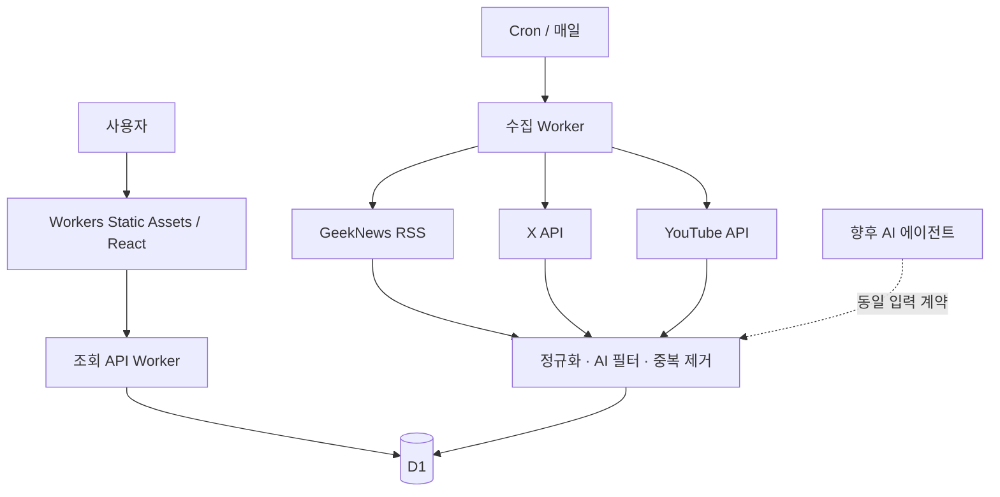

# AI News Crawler — 프로젝트 설계도

작성일: 2026-10-10 · 갱신일: 2026-10-11 · 상태: 로컬 첫 버전 구현·검증 완료, 배포 전 · 언어: 한국어 우선

## 0. 현재 구현 상태

서비스 가칭은 **AI SIGNAL**이다. 화면·조회 API·D1·수집 Worker를 구현했고 실제 GeekNews 50개 항목 중 AI 관련 16개를 로컬 D1에 저장해 화면에서 확인했다. React/TypeScript/Vite, Hono, D1, Cron의 기존 선택을 유지한다.

- 구현: 소스 탭, 검색, 주제/기간 필터, 커서 페이지네이션, 브라우저 북마크, 소스 상태·오류·빈 화면, 반응형 레이아웃.
- 구현: Atom 어댑터, YouTube 주제 검색·영상 상세 어댑터, X 최근 검색 어댑터, 규칙 기반 관련성 분류, 안전한 텍스트/URL 처리, 중복 upsert, 소스 실행 잠금과 수집 로그.
- 검증: 타입 검사·프로덕션 빌드, 도메인/실제 로컬 D1 테스트 22개, 브라우저 테스트 8개, 로컬 스케줄러 테스트 2개. 360/768/1440px와 실제 Worker→D1→화면 연결 확인. API·수집기 모두 Wrangler 배포 dry-run 통과.
- 실제 연결: YouTube 주제 검색에서 191개 AI 영상을 로컬 저장했다. X는 비용 때문에 보류한다. Hacker News 공식 API 수집과 전용 탭을 추가했다.
- 배포 전: 실제 Cloudflare D1 ID와 계정·배포 자격 증명 설정. CI와 수동 배포 워크플로 파일은 준비했다.
- 후속: 운영 알림, 플랫폼별 삭제·보존 동기화, 원격 즉시 수집, AI 요약, 의미 기반 소식 묶기.

아래 내용은 목표 설계이며, 첫 버전에서 구체화·조정한 사항은 다음과 같다.

1. 단일 루트 npm 패키지 안의 디렉터리 경계로 시작했다. 각 packages 폴더를 독립 배포하는 workspace 구성은 필요해질 때 분리한다.
2. 태그는 D1 JSON 배열로 저장하고 `json_each`로 필터링한다. 태그 관리 기능이 생기면 관계 테이블로 전환한다. 관련성 처리는 domain의 `Enricher` 계약과 `RuleBasedEnricher`가 담당한다.
3. 수집은 제한된 최신 구간의 스냅샷을 반복 처리한다. 아직 소스별 영속 페이지 커서는 없으며 상한에 걸리면 partial을 표시한다. YouTube는 최대 4주제×2정렬×25개 후보, X는 한 실행 최대 100개다.
4. X 예산은 실제 결제 금액이 아닌 보수적인 읽기 건수 예약으로 제한한다. 금액 상한은 X 콘솔에서 병행 설정한다.
5. GeekNews 링크는 공식 피드의 토론 페이지다. 외부 기사 URL 추출과 본문 수집은 하지 않는다. YouTube 영상 길이와 반응 지표를 저장한다. X 공식 계정 표시는 등록한 작성자 ID를 기준으로 하며 발표/소문 자동 분류는 후속이다.
6. ‘오늘의 AI’는 전체 수집 피드의 이름이고 기본 기간은 전체다. 최근 24시간은 필터로 선택한다. 중요도 평가 대신 최신 항목을 상단에 표시한다.
7. 배경은 CSS 그라데이션·궤도 그래픽·정적인 별 무늬로 구현했다. Canvas 애니메이션은 선택적 후속 효과다.

실행·연결·배포 절차는 [README.md](./README.md)를 따른다.

### 2026-10-11 구현 — 주제 검색으로 콘텐츠 발견

사용자 승인으로 주제 검색을 구현했다. YouTube는 최근 2일 최신순/7일 조회수순을 병합하고 X는 최신순/관련성순 검색을 읽기 예산 안에서 나눈다. 0002_discovery.sql에 지표와 분류를 추가했다. 조회수/좋아요는 최신 스냅샷이며 상승률은 계산하지 않는다.

- YouTube: 채널 ID를 필수 조건에서 빼고 AI 주제별 `search.list`를 기본으로 사용한다. 최근 7일 조회수순과 최근 24~48시간 최신순 결과를 함께 수집한다. 한국어·영어 검색어를 구성하고 영상 ID로 중복 제거한다. 언어 관련성 옵션은 엄격한 언어 필터가 아니다.
- 발견한 영상의 조회수·영상 길이는 `videos.list`로 조회한다. API 제공 정렬을 활용하고 채널별 노출 상한으로 다양성을 확보한다. 전체 플랫폼의 AI 인기 순위가 아니라 ‘검색한 AI 콘텐츠 중 최근 인기’로 설명한다. 채널 지정 모드는 추후 보조 기능으로 확장할 수 있다.
- 공개 YouTube 검색에도 API 키가 필요하지만 사전에 채널 목록을 지정할 필요는 없다. 전체 인기 차트는 지역·카테고리 기준이므로 AI 주제 검색을 대신하지 않는다.
- X: 현재 키워드 검색에 최신/관련성 후보 수집과 공개 반응 지표를 추가한다. 재게시·반복 홍보·중복 링크를 정리한다. 공식 계정 목록은 원출처 확인을 위한 보조 정보이며 수집의 필수 조건이 아니다. API 관련성 정렬을 인기순으로 단정하지 않는다.
- 화면 구현: YouTube는 최신/최근 인기/튜토리얼, X는 최신/화제의 글/공식 계정. 튜토리얼은 제목 표현, 공식 계정은 등록한 작성자 ID로 분류한다. 통합 화면에서 플랫폼별 조회수와 반응 수를 직접 비교하지 않는다.
- 운영 제안: 하루 한 번 소수 주제와 제한된 페이지로 시작하고 YouTube 검색 쿼터와 X 반환 리소스 과금에 각각 상한을 적용한다.
- DB 후속: 수집 경로·검색 주제, 소스별 지표와 확인 시각, 분류 근거를 저장한다. 기존 AI 관련성 score와 인기 지표를 분리한다. 단일 시점 지표만으로 ‘급상승’을 표시하지 않는다.

공식 자료: [YouTube 시작 안내](https://developers.google.com/youtube/v3/getting-started), [검색](https://developers.google.com/youtube/v3/docs/search/list), [영상 상세](https://developers.google.com/youtube/v3/docs/videos/list), [쿼터](https://developers.google.com/youtube/v3/determine_quota_cost), [X 검색](https://docs.x.com/x-api/posts/search-recent-posts), [X 과금](https://docs.x.com/x-api/getting-started/pricing).

## 1. 목표와 범위

GeekNews, X, YouTube의 최신 AI 관련 콘텐츠를 매일 자동 수집하고, 출처별 탭에서 빠르게 읽을 수 있는 웹 서비스를 만든다. 세 소스의 콘텐츠 형태는 기사·게시물·영상으로 구분한다. 디자인 완성도와 유지보수성을 함께 확보하며, 이후 AI 에이전트가 수집·분류·요약에 참여할 수 있도록 경계를 분리한다.

- 코드 저장소: https://github.com/farfromseoul/AI-News-Crawler.git
- 로컬 프로젝트: `/Users/allnewjh/projects/AI-News-Crawler`
- 호스팅: Cloudflare
- 현재 산출물: 실행 가능한 웹/API/수집기, 테스트, CI/배포 설정과 운영 문서. GitHub 푸시와 실제 배포는 아직 수행하지 않았다.
- 원격 저장소는 GitHub API로 main 브랜치에 README.md 한 파일이 있는 것을 확인했다. 현재 Mac의 Git은 Xcode Command Line Tools가 없어 실행되지 않으므로 실제 clone/연결·히스토리 통합은 후속으로 남아 있다.

## 2. 화면과 제품 아이디어

기본 탭은 `오늘의 AI / GeekNews / X / YouTube`를 추천한다. ‘오늘의 AI’는 동일한 데이터의 통합 보기이며, 초기에는 규칙 기반으로 최신 소식을 선별한다.

| 영역 | 동작 |
| --- | --- |
| 오늘의 AI | 최근 24시간 콘텐츠, 오늘의 핵심 소식, 소스별 수집 상태 |
| GeekNews | 제목·제공된 설명·태그·발행 시간·GeekNews 및 원문 링크 |
| X | 작성자·게시물·발행 시간·원문 링크. 소문과 공식 발표를 구분 |
| YouTube | 썸네일·제목·채널·영상 길이·발행 시간·영상 링크 |
| 공통 탐색 | 소스·주제·기간·언어 필터, 제목 검색, 최신순 기본 정렬 |

시각 방향은 사용자가 지정한 [Geniuskey Arcade](https://geniuskey.github.io/arcade/)를 참고한 ‘우주 분위기의 AI 뉴스룸’이다. 거의 검은 배경, 라임색 주요 버튼과 활성 탭, 보라·시안의 은은한 빛, 반투명 패널, 굵은 큰 제목과 외곽선 영문 장식을 사용한다. 구체적인 관찰과 적용 기준은 [DESIGN_REFERENCE.md](./DESIGN_REFERENCE.md)에 기록한다.

데스크톱 상단은 소개 문구와 오늘의 핵심 소식을 나란히 배치한다. 아래에는 검색·소스 탭·주제 필터와 뉴스 카드 그리드를 둔다. 뉴스 카드는 데스크톱 3열, 태블릿 2열, 모바일 1열을 기본으로 삼고, GeekNews와 X에는 간결한 목록 보기 옵션을 후속 제공한다. 원문 썸네일이 없는 콘텐츠는 텍스트 카드로 표현한다. 한글 제목의 가독성을 위해 레퍼런스의 작은 글자와 강한 음수 자간을 그대로 적용하지 않는다.

별 배경은 독립적인 Canvas 2D 장식 컴포넌트로 추가할 수 있다. 먼저 정적 그라데이션으로 화면을 완성하고, 모션은 기기 성능과 모션 감소 설정을 고려해 점진적으로 적용한다. 카드 이동·테두리 강조는 CSS로 처리한다. 키보드 탐색, 명확한 포커스, 터치 조작과 텍스트 대비를 함께 검증한다.

추천 확장 아이디어:

1. **같은 소식 묶기:** 같은 발표를 다룬 GeekNews·X·YouTube 콘텐츠를 연결해 관점을 비교한다. MVP는 동일 URL만 연결하고 의미 기반 묶기는 이후 도입한다.
2. **업데이트 투명성:** 마지막 성공 시각과 수집 지연을 보여준다. 하루 한 번 갱신을 ‘실시간’으로 표시하지 않는다.
3. **관심 주제:** 모델 출시, 개발 도구, 연구, 오픈소스, 산업 소식으로 필터링한다.
4. **북마크:** 초기에는 브라우저 로컬 저장. 계정 동기화는 후속 단계다.
5. **한국어 브리핑:** AI 요약 도입 후 원문과 요약을 구분하고 근거 링크를 제공한다.

## 3. 권장 기술과 배포 구성

| 부분 | 선택 | 이유 |
| --- | --- | --- |
| 웹 | React + TypeScript + Vite | 정적 배포와 화면 개발이 단순하며 API와 독립적 |
| 스타일 | Tailwind CSS + CSS 변수 + 전용 CSS | 색상·간격 토큰과 그라데이션·반투명 패널·카드 효과 관리 |
| 배경·모션 | CSS transitions/keyframes, 선택적 Canvas 2D | 레퍼런스의 빛·호버·별 배경을 가볍게 구현 |
| API | Cloudflare Workers + Hono | 조회 API와 Cloudflare 바인딩을 TypeScript로 관리 |
| 호스팅 | Workers Static Assets | 웹 정적 파일과 API를 같은 도메인에서 제공 |
| 저장 | Cloudflare D1 | 뉴스, 수집 기록, 설정의 관계형 저장 |
| 정기 실행 | 별도 수집 Worker + Cron Triggers | 사용자 조회와 수집 작업의 장애·배포를 분리 |
| 개발·배포 | Wrangler + GitHub Actions | 로컬 환경, 마이그레이션, 검증과 배포 자동화 |

**2026-10-10 디자인 검토 결정:** React·TypeScript·Vite와 Cloudflare 구성은 유지한다. 레퍼런스의 제공 HTML에서 외부 프레임워크나 3D 라이브러리 없이 CSS와 Canvas 2D로 효과를 구현한 것을 확인했다. 요구된 디자인은 현재 스택으로 구현 가능하며, Three.js·WebGL·GSAP·Motion을 기본 의존성에 추가할 필요가 없다. 향후 복잡한 전환 요구가 생기면 해당 기능 범위에서 다시 판단한다.

초기에는 웹/API Worker와 수집 Worker 두 개로 충분하다. Queues, Workflows, R2는 지금 필수 의존성으로 넣지 않는다. 수집량·처리 시간이 늘면 Queues로 소스 작업을 나누고, 긴 에이전트 작업은 Workflows 또는 외부 실행기에 맡긴다.



## 4. 수집 전략

| 소스 | MVP 수집 방법 | 제약과 대응 |
| --- | --- | --- |
| GeekNews | 공식 RSS를 파싱하고 제목·설명에서 AI 관련 항목 선별 | 실제 피드 필드·수록 범위를 샘플로 확인. 하루 사이 피드에서 사라진 항목은 놓칠 수 있어 운영 관찰 후 빈도 조정 |
| X | 공식 API로 선정 계정과 제한된 검색어 조회 | 자격 증명과 유료 사용량 관리 필요. 예산/호출/반환 건수 상한 적용 |
| YouTube | 주제별 최신순·조회수순 검색 후 영상 상세 조회 | API 키와 쿼터 필요. 검색을 무제한 사용하지 않고 페이지 수 제한 |

초기 AI 필터는 키워드와 제외 규칙을 조합한다. `AI`, `LLM`, `인공지능`, 모델·기관 이름을 설정 파일에 관리하고 단어 경계를 적용한다. `AI` 문자열이 포함되었다는 이유만으로 일반 단어를 매칭하지 않는다. 제목·설명만으로 관련성을 판단하기 어려운 항목은 낮은 신뢰도로 표시하거나 제외한다.

첫 실행은 최근 7일 범위 안에서 소스별 건수 상한을 적용한다. 이후에는 마지막 성공 커서와 48시간 겹침 구간을 활용하되, 소스가 실제로 제공하는 범위까지만 조회한다. 전체 본문·영상·자막 수집은 MVP에서 제외한다. 외부 HTML은 그대로 렌더링하지 않고 제공된 텍스트를 정제한다. 제공 콘텐츠의 표시·보존·삭제는 각 플랫폼 정책에 맞게 구현 전 확인한다.

키가 없는 소스는 `not_configured`로 표시한다. 해당 탭은 유지하고 실제 연결 상태를 안내한다. 샘플 데이터는 개발 모드에서만 사용하고 실제 수집 데이터로 오인시키지 않는다.

## 5. 모듈 경계와 에이전트 확장

수집 어댑터는 외부 통신만, 파이프라인은 데이터 정규화·판별만, 저장소는 DB 접근만 담당한다. 화면에서 외부 소스 API를 직접 호출하지 않는다.

```ts
type Source = 'geeknews' | 'x' | 'youtube';

interface SourceAdapter {
  source: Source;
  fetch(input: {
    since: string;
    cursor?: string;
    maxItems: number;
  }): Promise<{
    items: SourceItem[];
    nextCursor?: string;
    complete: boolean;
  }>;
}

interface Enricher {
  enrich(item: NormalizedItem): Promise<EnrichmentResult>;
}
```

`SourceItem`은 소스 ID·URL·제목·발행 시간·제공 설명·작성자 등 공통 필드를 가진 입력 계약이다. 구체적인 스키마와 런타임 검증은 구현 때 정의한다. `NormalizedItem`은 URL 및 시간 정규화를 마친 데이터이고, `EnrichmentResult`는 태그·관련성·선택적 요약·처리 버전을 가진다.

MVP에서는 `RuleBasedEnricher`를 사용한다. 이후 `AgentEnricher`를 추가해 같은 계약으로 교체한다. 에이전트는 허용된 도구와 출처만 사용하고, 구조화된 결과를 검증받아 기존 파이프라인으로 들어온다. 웹 콘텐츠 안의 지시는 데이터로 취급한다. 수집 및 공개 기준을 에이전트가 직접 변경하지 못하도록 한다.

요약에는 모델/프롬프트 버전과 생성 시각을 기록한다. 실패하면 원문 메타데이터를 계속 제공하고, 낮은 신뢰도 결과는 검토 대상으로 남긴다. 뉴스 조회 요청 중에는 에이전트를 실행하지 않는다.

## 6. 데이터 설계

| 테이블 | 핵심 필드와 용도 |
| --- | --- |
| items | id, source, external_id, content_type, title, url, canonical_url, author, published_at, collected_at, source_excerpt, thumbnail_url, language, relevance_score, status |
| tags / item_tags | 주제 태그와 콘텐츠 연결 |
| source_state | source, cursor, last_attempt_at, last_success_at, status, error_code |
| ingestion_runs | id, source, window, started_at, finished_at, fetched/inserted/skipped 수, status, error_code |
| enrichments | item_id, processor_version, summary, confidence, generated_at; AI 도입 시 사용 |
| story_links | item_id, related_item_id, method, confidence; 콘텐츠 묶기 도입 시 사용 |

`UNIQUE(source, external_id)`로 재실행 시 중복 삽입을 막는다. 추적 파라미터만 제거한 canonical URL로 같은 링크를 연결하며, 서로 다른 소스의 기록은 보존한다. 제목 유사도만으로 삭제하지 않는다. 게시 시각이 없으면 NULL로 보관하고 수집 시각을 대체 정렬 값으로 사용한다.

시간은 UTC로 저장하고 UI에서 Asia/Seoul로 표시한다. 주요 인덱스는 `(source, published_at, id)`, `(published_at, id)`, 태그 연결 키다. 검색은 초기 제목 검색으로 제한하고 데이터 증가 시 FTS 도입 여부를 판단한다. 마이그레이션은 버전 관리한다.

## 7. API와 운영

- `GET /api/items?source=&tag=&q=&cursor=&limit=`: 필터 목록, 최대 limit 50, 안정적인 복합 커서 정렬.
- `GET /api/items/:id`: 상세 메타데이터와 원문 링크.
- `GET /api/sources/status`: 마지막 성공 시각, 상태, 지연 여부. 내부 오류와 키는 노출하지 않는다.
- `GET /api/health`: API 상태. 수집 성공 여부는 별도 상태 API로 판단한다.
- 수집 실행: Cron과 인증된 운영 CLI로 수행한다. 공개 수집 실행 엔드포인트는 만들지 않는다.

초기 일정은 매일 09:00 KST (`0 0 * * *`, UTC)로 제안한다. 소스별 작업을 독립적으로 기록해 한 소스가 실패해도 나머지를 처리한다. 09:00은 실행 시작 시각이며 완료를 보장하는 시각은 아니다.

429/일시적 5xx는 Retry-After와 지수 백오프를 사용하고 재시도 횟수를 제한한다. 인증 실패는 반복하지 않는다. 페이지별 상한과 실행 시간 예산을 두며, 정상 저장된 페이지 이후에만 커서를 갱신한다. 실행이 중단되어도 재실행으로 복구 가능해야 한다. 중복 실행은 DB의 만료 가능한 실행 잠금과 unique 제약으로 방어한다.

조회 결과는 짧게 캐시하고 클라이언트 재조회 정책을 둔다. 오래된 데이터를 유지하되 갱신 지연을 표시한다. 구조화 로그에는 run_id·source·duration·오류 분류·건수를 남기고 인증 정보는 제외한다. 일일 실패와 26시간 이상 갱신 지연을 운영 알림 대상으로 삼는다. 알림 채널은 배포 단계에서 정한다.

비밀은 Workers Secrets와 git 제외 로컬 환경 파일에 저장한다. `.env.example`에는 키 이름만 남긴다. 원문에서 추출한 임의 URL을 서버가 자유롭게 요청하지 않도록 수집 대상 도메인을 제한한다. 필요 시 Cloudflare Access로 운영 기능을 보호한다.

X 비용은 호출 횟수만이 아니라 반환 리소스 수로 계산한다. 소스별 일일 건수와 월 예산을 설정하고 플랫폼 지출 상한도 함께 사용한다. Cloudflare/YouTube 쿼터와 런타임 제한은 구현·배포 시 공식 문서 및 계정 콘솔에서 재확인한다.

## 8. 디렉터리 구성

```text
AI-News-Crawler/
├── ARCHITECTURE.md
├── DESIGN_REFERENCE.md
├── Owner.md
├── AGENTS.md
├── apps/
│   └── web/                  # React 화면
├── workers/
│   ├── api/                  # 조회 API + static assets 바인딩
│   └── collector/            # Cron 진입점
├── packages/
│   ├── domain/               # 스키마·정규화·필터·중복 규칙
│   ├── sources/              # GeekNews/X/YouTube 어댑터
│   ├── storage/              # D1 repository
│   └── enrichment/           # 규칙 처리, 향후 agent 처리
├── migrations/
├── fixtures/                 # 실제 형식의 비밀 없는 샘플
└── .github/workflows/        # 검증 및 배포
```

하나의 저장소와 TypeScript workspace를 사용한다. 작은 함수는 가까운 모듈에 두고, 실제 공유 계약에만 packages 경계를 사용한다.

## 9. 구현 순서와 완료 기준

1. **기반:** 기존 GitHub 저장소 확인·연결, workspace와 로컬 D1, 마이그레이션, 샘플 화면. 새 파일과 기존 작업의 충돌을 먼저 확인한다.
2. **첫 수직 구현:** GeekNews RSS → 필터 → D1 → API → 화면을 실제 데이터로 연결하고 Cron 실행을 검증한다.
3. **세 소스 통합:** YouTube와 X 어댑터, 키 미설정 상태, 예산 제한, 소스별 탭, 검색·필터, 업데이트 상태.
4. **완성도와 운영:** 모바일·접근성·오류/빈 상태, 관측 로그, 배포 파이프라인, 복구 절차, 운영 문서.
5. **후속 확장:** AI 요약·관련 뉴스 묶기·일일 브리핑, 필요할 때 큐·장기 실행·계정 기능.

MVP 완료 기준:

- 연결된 소스가 하루 한 번 자동 갱신되고 UI에서 실제 성공 시각을 확인할 수 있다.
- 같은 입력을 재실행해도 중복이 생기지 않으며 소스 하나의 실패가 다른 소스를 막지 않는다.
- 키 미설정·인증 실패·쿼터 초과·빈 결과·갱신 지연이 올바르게 구분된다.
- 핵심 필터·정규화·커서/중복 저장·재시도 경로를 fixture 기반 테스트로 검증한다.
- 로컬 D1 통합 검증과 모바일 목록→필터→원문 이동의 기본 E2E 검증을 통과한다.
- 디자인은 360px·768px·1440px 화면에서 긴 한글 제목·썸네일 없음·로딩/빈 상태를 검증하고, 키보드 조작과 모션 감소 설정에서도 탐색 가능해야 한다.
- 비밀이 코드와 웹 번들에 없고, 스테이징에서 Cron·API·정적 파일 경로를 확인한다.

## 10. 초기 가정과 구현 시 결정할 항목

초기 가정: 한국어 UI, 매일 09:00 KST 갱신, 로그인 없는 공개 열람, 원문 링크 중심, AI 요약은 후속 단계.

구현 시 결정: X 월 예산과 계정 목록, YouTube 검색 주제, 최종 서비스명과 도메인, Cloudflare 계정/환경, 플랫폼별 보존 정책. 비용이 필요한 소스는 예산과 자격 증명이 정해진 뒤 활성화하고 그 전에는 미연결 상태로 구현한다.

## 11. 공식 자료

2026-10-10 확인. 아래 자료는 현재의 설계 근거이며 비용·제한은 구현 시 다시 확인한다.

- [Cloudflare Workers Static Assets](https://developers.cloudflare.com/workers/static-assets/): 정적 웹과 Worker API 호스팅.
- [Cloudflare Cron Triggers](https://developers.cloudflare.com/workers/configuration/cron-triggers/): scheduled 핸들러 기반 정기 실행.
- [Cloudflare D1](https://developers.cloudflare.com/d1/): 서버리스 SQL 저장소.
- [GeekNews 공식 RSS 안내](https://news.hada.io/topic?id=5674): 공식 피드 제공.
- [YouTube search.list](https://developers.google.com/youtube/v3/docs/search/list) 및 [쿼터 안내](https://developers.google.com/youtube/v3/determine_quota_cost): 검색 파라미터와 쿼터 확인.
- [X API 가격 안내](https://docs.x.com/x-api/getting-started/pricing): 사용량 기반 과금과 지출 상한.

### 2026-10-11 — X 연결 보류 및 YouTube 연결 준비

- 사용자가 읽기 비용 때문에 X 연결을 보류했다. 로컬 X 일일·월간 상한을 0으로 유지하며 유료 호출하지 않는다.
- YouTube 수집 구현은 완료됐으나 이번 실행 시 디스크의 YOUTUBE_API_KEY 값이 비어 있어 not_configured로 종료했다. IDE에서 키를 저장한 뒤 실제 수집 검증이 필요하다.
- 무료 대체 후보: Hacker News 공식 공개 API(https://github.com/HackerNews/API). 최신·인기 글에서 AI 관련 항목을 선별하는 방식 권장. Bluesky는 소셜 게시물 대안으로 검토하되 검색 인증과 제공 범위를 확인해야 한다. 대체 플랫폼은 아직 구현하지 않았다.

### 2026-10-11 — YouTube 실연결 및 Hacker News 추가

YouTube 실제 수집 192개 후보 중 191개 저장. Hacker News를 네 번째 Source로 추가하고 최신·인기 목록을 교차 병합해 최대 100개 항목을 5개씩 조회한다. 삭제/비공개(dead)/비기사 항목 제외, 기존 규칙 기반 AI 분류 적용. points와 commentCount는 별도로 저장하고 화면에 표시하며 AI 관련성 score와 혼합하지 않는다. 일부 개별 조회 실패 시 성공한 항목을 저장하고 partial, 모두 실패하면 error를 기록한다.

0003은 items 소스 CHECK 제약 확장을 위해 기존 행을 새 테이블에 복사하고 인덱스를 재생성한다. SourceAdapter/정규화/저장소/화면 경계를 유지한다. 단일 소스 CLI 옵션을 추가해 추가 수집 시 YouTube 쿼터를 불필요하게 사용하지 않는다.

### 2026-10-11 — Hacker News 원문 링크 수정

카드 제목은 공식 API의 url(HTTP/HTTPS)을 우선 사용하고 원문 URL이 없거나 유효하지 않을 때만 HN 게시글로 연결한다. 기존 저장 항목의 url/canonical_url도 개별 항목 API로 갱신한다. 외부 본문 자체는 수집하지 않는다.

### 로컬 예약 수집

별도 Node 프로세스 `npm run scheduler`를 추가했다. UTC 00:00(한국 09:00)에 기존 collect.ts를 자식 프로세스로 실행하고 PID 잠금 및 실행 중 플래그로 중복을 제한한다. 프로세스 생존 중 절전 누락은 깨어난 뒤 한 번 실행한다. 재부팅 자동 시작은 등록하지 않으며 Cloudflare 예약과는 별개다.

### 운영 D1 설정

사용자가 생성한 ai-sig(9efaed65-69cc-4bc6-b11e-da5bb4d43458)를 두 Worker에 동일하게 연결한다. preview_database_id는 기존 로컬 DB 식별자를 유지한다. 실제 원격 마이그레이션과 배포는 별도 진행하며 무료 Worker 수집 요청 한도 대응은 아직 필요하다.

### 무료 플랜 수집 상한

외부 호출 상한: GeekNews 최대 3(재시도 포함), YouTube 최대 12, X 최대 2(현재 비활성), Hacker News 목록 2+항목 30=32(재시도 없음). 합계 최대 49. 자동 리다이렉트를 차단해 숨은 추가 요청을 방지한다. 내부 D1 호출은 별도 한도이며 실제 CPU 사용량은 운영에서 검증해야 한다.
