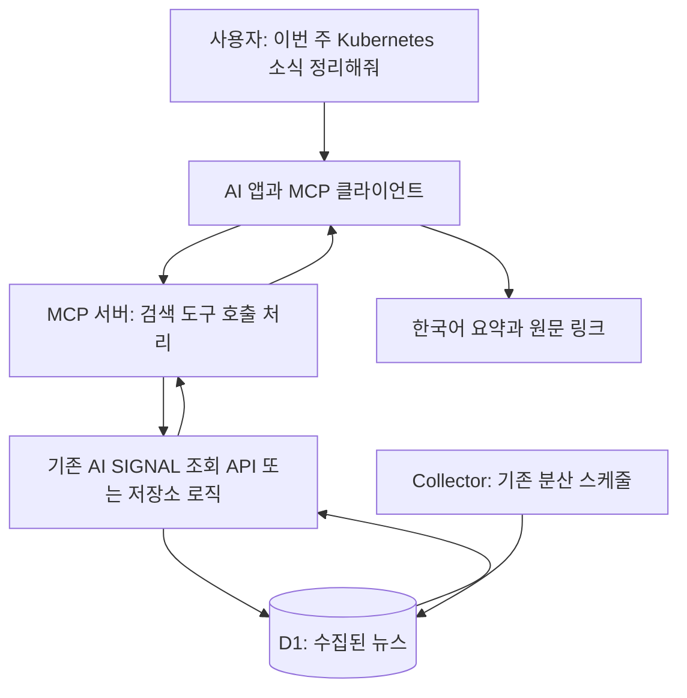

# AI SIGNAL MCP — 제작과 활용 가이드

작성일: 2026-10-12 · 상태: 설계 제안, MCP 서버 구현·배포 전

## 1. 핵심 요약

MCP(Model Context Protocol)는 AI 애플리케이션이 외부 데이터와 기능을 사용할 수 있게 연결하는 표준이다. AI SIGNAL에 적용하면 AI에게 “이번 주 Kubernetes 뉴스 정리해줘”라고 말하고, AI가 저장된 뉴스를 검색해 근거 링크와 함께 답하게 할 수 있다.

우리가 만드는 것은 **기존 뉴스 조회 기능을 AI가 호출할 수 있도록 제공하는 MCP 서버**다. 뉴스 수집은 기존 Collector가 계속 담당하고, 요약·해석은 연결된 AI가 담당한다. MCP 자체가 AI 모델이거나 자동 실행 스케줄러인 것은 아니다. [공식 MCP 구조 설명](https://modelcontextprotocol.io/docs/learn/architecture)

추천 순서: **로컬 읽기 전용 MCP → 실제 질문으로 검증 → 필요할 때 Cloudflare 원격 MCP → 자동 브리핑**.

## 2. 어떻게 동작하나?



1. 클라이언트가 MCP 서버에 연결해 제공 도구와 입력 형식을 확인한다.
2. 사용자가 질문하면 AI가 적절한 도구와 검색 조건을 선택한다.
3. MCP 서버는 조건을 검증하고 기존 데이터를 조회한다.
4. 제목·발췌문·태그·발행일·원문 링크를 반환한다.
5. AI가 반환된 자료를 근거로 답한다. 도구 사용 허용 방식은 클라이언트 설정에 따른다.

일반 REST API만 만든다고 MCP 연결이 되는 것은 아니다. MCP SDK로 도구 목록, 호출 처리, 입력·출력 계약, 전송 방식을 제공해야 한다.

## 3. AI SIGNAL에서 사용할 도구

아래 이름은 제안이며 현재 등록된 MCP 도구는 없다.

| 단계 | 도구 | 역할 | 기존 코드 활용 |
| --- | --- | --- | --- |
| 1차 | `search_news` | 검색어·출처·태그·기간별 뉴스 검색 | `GET /api/items`, `NewsRepository.list` |
| 1차 | `get_news_item` | 선택한 항목의 저장 정보 조회 | `GET /api/items/:id`, `NewsRepository.get` |
| 1차 | `get_collection_status` | 출처별 마지막 수집·오류 상태 확인 | `GET /api/sources/status`, `NewsRepository.status` |
| 후속 | `get_topic_stats` | 검색 결과의 분야 비중·태그 빈도 | `GET /api/stats`, `NewsRepository.stats` |
| 후속 | `get_conference_news` | 행사별 관련 콘텐츠 검색 | 기존 section·conference 필터를 활용 |
| 후속 | `compare_periods` | 이번 주와 이전 주 기사 수 비교 | 날짜 범위 조회·동일 길이 기간 비교 추가 필요 |

현재 기간 필터는 `all`, `1d`, `7d`다. 임의 날짜 범위나 전주 대비 증감은 기존 API 기능으로 단정하지 않고 후속 구현한다. 집계는 수집된 자료 안의 빈도이며 전체 업계 인기 순위가 아니다.

도구 입력 예시(설계용):

```json
{
  "query": "kubernetes",
  "period": "7d",
  "section": "engineering",
  "limit": 10
}
```

`query`를 기존 API 검색 필드로 변환하는 어댑터를 둔다. 결과는 기존 항목 ID, 제목, 출처, 발췌문, 태그, 발행일, 링크와 다음 페이지 정보를 포함하도록 설계한다. `content_type: "excerpt"`처럼 본문 범위를 명시하고, 마지막 수집 상태는 상태 도구로 확인한다.

## 4. 어떻게 만드나?

### 1단계 — 로컬에서 작은 서버 만들기

TypeScript 공식 SDK를 사용해 `search_news`, `get_news_item`, `get_collection_status` 세 도구를 등록한다. 도구마다 설명, 입력 스키마, 반환 형식과 오류 처리를 정의한다. SDK 버전과 지원 프로토콜은 구현 시 고정하고 클라이언트와 맞춘다. [공식 TypeScript SDK](https://ts.sdk.modelcontextprotocol.io/)

제안 폴더 구조(아직 생성하지 않음):

```text
packages/mcp/
  tools.ts             # 도구 정의, 검증, 응답 변환
  news-client.ts       # 기존 조회 API 호출
scripts/mcp-stdio.ts   # 로컬 실행 진입점
tests/mcp.test.ts      # 검색·오류·출력 제한 검사
```

첫 버전은 로컬 MCP가 기존 HTTP API를 호출하도록 한다. Node 프로세스에 Cloudflare D1 바인딩을 직접 연결하려고 하지 않아도 된다. API 주소는 설정으로 주입하고 허용된 주소만 사용한다.

로컬에서는 **stdio**로 클라이언트와 통신한다. 클라이언트가 서버 프로세스를 실행하고 표준 입출력으로 메시지를 주고받는다. 일반 로그는 stderr로 보내 프로토콜 메시지와 섞이지 않게 한다. 원격에서는 **Streamable HTTP**로 연결한다. [Cloudflare MCP 연결 방식](https://developers.cloudflare.com/agents/model-context-protocol/)

### 2단계 — 도구만 먼저 검증하기

MCP Inspector로 연결·도구 목록·실제 호출을 확인한다. [공식 Inspector 안내](https://modelcontextprotocol.io/docs/tools/inspector)

- 정상 검색, 결과 없음, 잘못된 출처·기간, 존재하지 않는 ID를 확인한다.
- API 장애와 인증 실패를 빈 결과와 구분한다.
- 결과 건수·응답 길이·타임아웃을 제한한다.
- MCP 조회가 Collector 실행이나 YouTube API 호출로 이어지지 않는지 확인한다.

### 3단계 — AI 클라이언트에 연결하기

로컬 stdio를 지원하는 클라이언트에는 실행 명령과 인자를 등록한다. 다음은 **빌드 경로를 이 구조로 구현했을 때의 예시**이며 현재 실행할 수 있는 설정은 아니다. 설정 파일 위치·키 이름·환경 변수 처리 방식은 선택한 클라이언트 문서에 맞춘다.

```json
{
  "mcpServers": {
    "ai-signal": {
      "command": "node",
      "args": ["/절대경로/AI-News-Crawler/dist-mcp/mcp-stdio.js"],
      "env": {
        "AI_SIGNAL_API_BASE_URL": "http://127.0.0.1:8787"
      }
    }
  }
}
```

로컬 API를 실행한 뒤 클라이언트에서 MCP를 연결하고 세 도구가 표시되는지 확인한다. 이후 실제 질문을 보내 도구 호출 내역과 응답의 출처를 확인한다. 클라우드에서 실행되는 클라이언트는 사용자 컴퓨터의 localhost에 직접 접근할 수 없으므로 원격 서버가 필요하다.

### 4단계 — Cloudflare 원격 서버로 확장하기

여러 기기에서 사용하려면 별도 `ai-signal-mcp` Worker에 `/mcp` 엔드포인트를 제공하는 구성을 제안한다. Cloudflare는 MCP 서버 배포를 지원한다. [Cloudflare MCP 안내](https://developers.cloudflare.com/agents/model-context-protocol/)

1. Workers와 호환되는 MCP HTTP 핸들러를 선택한다.
2. 기존 조회 API를 호출하거나 공통 `NewsRepository`를 D1 바인딩과 함께 재사용한다.
3. 클라이언트가 지원하는 인증을 구성한다. 개인용 토큰 방식은 인증 헤더 지원을 확인하고, OAuth 연결이 필요한 클라이언트에는 해당 흐름을 구현한다.
4. 읽기 도구만 노출하고 사용자별 호출 제한을 적용한다. D1 바인딩 자체가 읽기 전용 권한이라는 뜻은 아니므로 도구 구현에서 쓰기 경로를 제공하지 않는다.
5. 로컬 검증 후 별도 Wrangler 설정과 배포 작업을 추가한다.
6. 클라이언트에 배포된 MCP URL을 등록하고 인증·도구 호출을 확인한다.

별도 Worker는 인증과 배포 범위를 분리하려는 제안이며 MCP의 필수 조건은 아니다. 기존 API Worker에 `/mcp`를 추가하는 방식도 가능하다. 이 문서 작성으로 Worker·D1·스케줄은 변경되지 않는다.

## 5. 실제 사용 용도와 질문 예시

| 용도 | 사용자 질문 | 기대 결과 |
| --- | --- | --- |
| 아침 기술 브리핑 | “최근 7일 DevOps 뉴스 중 읽을 글 5개 골라줘.” | 수집된 자료 기반 요약과 선정 이유·링크 |
| 아키텍처 검토 | “IAM과 Zero Trust 관련 소식 찾아서 설계 검토 항목으로 정리해줘.” | 출처가 있는 변화와 AI의 제안을 구분 |
| 컨퍼런스 학습 | “KubeCon 관련 글 중 플랫폼 엔지니어링에 도움 되는 자료 찾아줘.” | 행사 관련 콘텐츠와 실무 적용 질문 |
| 운영 확인 | “CNCF 뉴스가 오래됐는데 마지막 수집 상태 확인해줘.” | 마지막 시도·성공·오류에 근거한 설명 |
| 학습 계획 | “찾은 Kubernetes 글 3개로 주말 실습 계획 만들어줘.” | 자료 기반 실습 제안과 예상 학습 순서 |
| 분야 통계 | “최근 7일 수집된 자료의 분야별 비중 보여줘.” | 통계 도구 구현 후 집계값과 설명 |

추천 요청 템플릿:

> 최근 7일 수집된 engineering 콘텐츠에서 Kubernetes, IAM, Terraform 관련 자료를 찾아줘. 중복 소식은 묶고 읽을 글 5개를 선정해줘. 각 항목에 핵심 내용, DevOps/SA 업무와의 관련성, 원문 링크를 붙여줘. 저장된 발췌문만으로 알 수 없는 내용은 추측하지 말고, 수집이 지연된 출처가 있으면 알려줘.

## 6. 요약·자동화·비용의 경계

**요약:** 서버는 저장 자료를 반환하고 연결된 AI가 요약한다. 초기 MCP 서버에 별도 LLM API 키는 필요하지 않지만, 사용하는 AI 서비스의 요금·사용 한도는 적용될 수 있다. 저장된 발췌문을 기사 전문이나 영상 자막으로 표현하지 않는다.

**자동화:** MCP 연결만으로 매일 알림이 발송되지는 않는다. 자동 브리핑에는 별도 스케줄러 → AI 실행 → MCP 조회 → 결과 생성 → 승인된 전달 채널이 필요하다. 기존 Collector Cron은 뉴스 수집만 담당한다.

**비용 관리 제안:** 첫 버전은 저장 자료만 읽고 강제 수집·원문 전체 크롤링 도구는 제외한다. 기본 10개, 최대 20개 응답과 페이지네이션으로 시작하고 짧은 조회 캐시·사용자별 호출 제한을 검토한다. 이는 제안값이며 아직 적용되지 않았다. 작은 응답 제한만으로 DB 읽기량까지 제한되지는 않으므로 집계 쿼리 실행량도 측정한다. Workers·D1·AI 서비스 사용량이 있어 무료를 보장하지 않는다.

**자료 취급:** 기사 안의 명령문은 외부 콘텐츠로 취급하고 실행 지시로 따르지 않는다. 원문 링크·발행 시각을 유지하고, 인증 토큰이나 내부 운영 비밀은 도구 응답에 포함하지 않는다.

## 7. 1차 완료 기준

- 세 가지 읽기 도구가 Inspector와 선택한 AI 클라이언트에서 동작한다.
- 답변에 실제 저장 항목의 링크가 포함되고 없는 자료를 생성하지 않는다.
- 수집 지연·빈 결과·API 오류를 구분해 설명한다.
- 호출 상한과 입력 검증이 적용되고 조회 중 외부 수집이 발생하지 않는다.
- README에 실제 실행·연결·종료 방법을 추가한다.

현재 완료된 것은 이 활용·설계 문서다. MCP 코드, 클라이언트 연결, 원격 배포, 자동 브리핑은 후속 구현 범위다.

## 구체적인 개발 계획 (2026-10-12)

최신 개발 순서는 [OpenAPI·Swagger UI 계획](./OPENAPI_SWAGGER_PLAN.md) 완료 후 [MCP 서버 계획](./MCP_SERVER_PLAN.md) 진행이다. MCP 검색 입력은 위 개념 예시의 `query` 대신 기존 REST와 동일한 `q`로 통일한다. 상태 도구는 현재 공개 API의 상태·시각만 제공하며 내부 오류 코드는 제공하지 않는다. 원격 SDK·인증·전송 선택은 MCP 서버 계획을 따른다.
