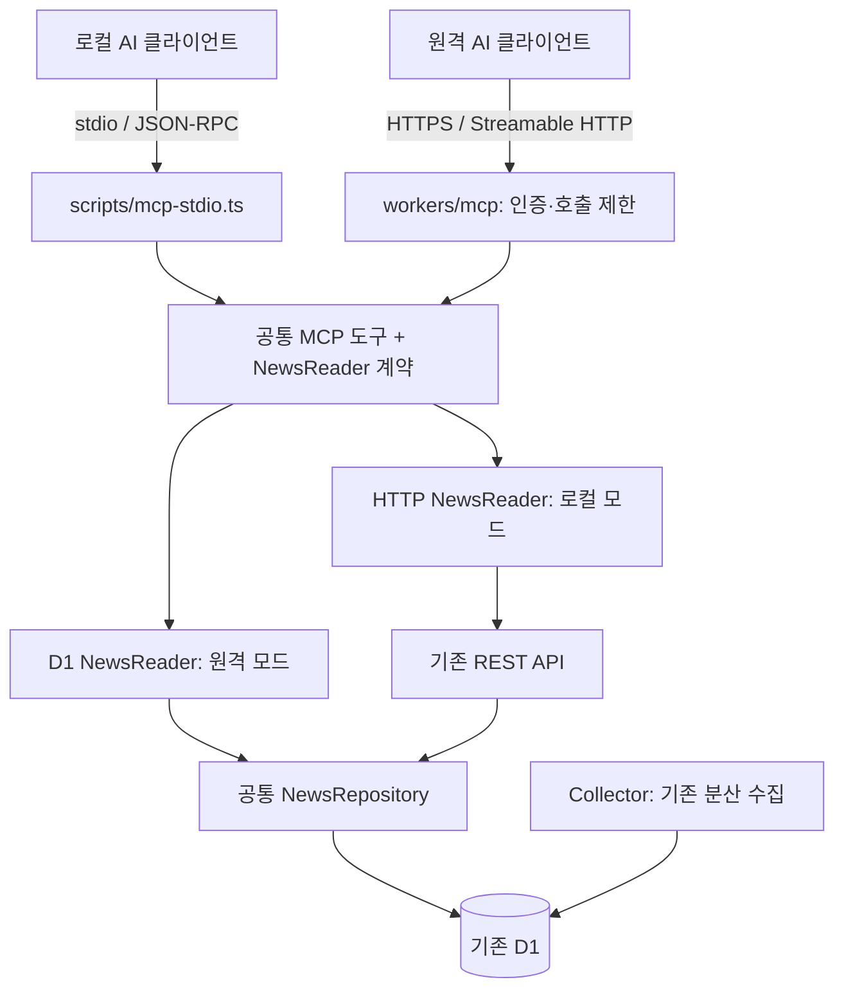

# 2단계 — AI SIGNAL MCP 서버 구축 계획·아키텍처

작성일: 2026-10-12 · 상태: 계획 완료 / 구현 전

## 선행 조건과 목표

[OpenAPI·Swagger 계획](./OPENAPI_SWAGGER_PLAN.md)의 계약 정리와 API 검증을 먼저 완료한다. 같은 저장소의 공통 타입·검증·조회 로직을 활용해 AI가 뉴스를 검색하는 MCP 서버를 만든다. 사용자 관점의 개념·질문 예시는 [MCP_GUIDE.md](./MCP_GUIDE.md)를 참고한다.

1차 기능은 `search_news`, `get_news_item`, `get_collection_status` 세 개다. 로컬 stdio에서 검증한 뒤 인증된 원격 Streamable HTTP로 확장한다. 수집·AI 요약 실행·자동 알림·DB 쓰기는 1차 도구 범위에 포함하지 않는다.

## 저장소와 배포 구조

현재 단일 npm 패키지 안에 폴더를 추가한다. 초기부터 workspace 관리 도구를 도입하지 않는다. 코드 저장소는 공유하지만 원격 MCP는 별도 Worker로 배포한다.



```text
packages/contracts/              # 1단계에서 정리한 공통 계약
packages/mcp/
  server.ts                      # SDK 서버 생성·도구 등록
  tools.ts                       # 입력 검증·공통 도구 처리
  reader.ts                      # NewsReader 인터페이스
  http-reader.ts                 # REST 호출·응답 검증
  d1-reader.ts                   # NewsRepository 어댑터
  errors.ts                      # 안전한 도구 오류 변환
scripts/mcp-stdio.ts              # Node 진입점·stderr 로그
workers/mcp/index.ts              # Workers HTTP 진입점
wrangler.mcp.jsonc               # 별도 Worker 및 D1 바인딩
tsconfig.mcp.json                # 로컬 실행 파일 빌드
tests/mcp/                       # 도구·전송·인증 통합 검사
```

파일명과 npm 명령은 구현 시 확정한다. 위 경로·서버는 아직 생성되지 않았다.

`NewsReader`는 list/get/status만 제공한다. 로컬과 원격 어댑터가 동일한 필터·커서·응답 계약을 따르는지 검증한다. 공통 도구 모듈이 Node 전용 API나 Workers 전역에 직접 의존하지 않게 한다.

## 도구 계약

| 도구 | 입력 | 반환 | 유의점 |
| --- | --- | --- | --- |
| search_news | q/source/tag/section/conference/period/sort/kind/limit/cursor | 항목 배열·total·nextCursor | REST 이름을 재사용, 기본10·최대20 제안 |
| get_news_item | id | 저장된 항목 상세 | 없는 ID를 정상 자료처럼 반환하지 않음 |
| get_collection_status | 없음 | 출처별 상태·시각·count·stale | 원인 로그·비밀·내부 잠금 정보 제외 |

검색어 필드는 초기 가이드의 `query` 예시에서 **기존 REST와 같은 `q`로 통일**한다. MCP의 낮은 응답 상한은 도구 계층에서 적용하며 REST의 기존 최대50을 변경하지 않는다.

- 입력은 공통 조건과 교차 필드 규칙으로 검증한다. 커서는 불투명 값으로 전달한다.
- 결과에 제목·발췌문·출처·원문 링크·발행일·수집일·태그를 포함하고 `contentType: excerpt` 같은 표시로 자료 범위를 구분한다.
- 구조화된 결과와 읽을 수 있는 짧은 텍스트를 제공한다. 큰 결과는 명시적 페이지네이션으로 제한하고 임의 자동 전체 순회를 하지 않는다.
- 현재 상태 API에 `error_code`는 없다. 상태가 error라는 사실만으로 네트워크·인증 문제를 단정하지 않는다.
- 도구 실행 실패와 JSON-RPC 프로토콜 오류는 SDK 규약대로 구분한다. API 400/404/503과 타임아웃을 내부 정보 없이 설명한다.
- 도구 설명과 읽기 전용 힌트를 제공하되 힌트 자체를 보안 통제로 취급하지 않는다.

분야 통계·컨퍼런스 전용 도구·기간 비교는 세 도구의 실사용 검증 후 추가한다. MCP 서버가 별도 LLM을 호출하지 않으므로 서버 측 모델 API 키는 1차에 필요하지 않다.

## 프로토콜과 SDK

로컬은 stdio, 원격은 HTTPS 기반 Streamable HTTP를 사용하며 MCP 메시지는 JSON-RPC 규약을 따른다. SDK에 도구 목록/호출·연결 호환 처리를 맡기고 프로토콜을 수작업 구현하지 않는다. [MCP 아키텍처](https://modelcontextprotocol.io/docs/learn/architecture)

구현 시작 시 공식 TypeScript SDK와 Cloudflare 핸들러의 호환 조합을 확인한다. 현재 Cloudflare 문서는 SDK v2 서버 팩토리와 `createMcpHandler`의 stateless 구성을 안내한다. 기존 v1 튜토리얼의 import와 섞지 않고 패키지·프로토콜·테스트 클라이언트 버전을 기록한다. [Cloudflare MCP handler API](https://developers.cloudflare.com/agents/model-context-protocol/apis/handler-api/)

읽기 요청 사이에 세션 상태가 필요 없으므로 stateless를 기본으로 한다. Durable Objects나 별도 대화 저장소는 첫 버전에 추가하지 않는다. 실제 클라이언트의 지원 프로토콜을 연결 시험으로 확인한다.

## 접속·인증 설계

| 환경 | 접속 정보 | 인증·실행 |
| --- | --- | --- |
| 로컬 | Node 실행 파일의 절대 경로·인자 | AI 앱이 자식 프로세스로 실행 |
| 원격 | 배포 후 발급될 `https://<mcp-worker-host>/mcp` | HTTPS + 선택 클라이언트와 호환되는 인증 |

로컬 환경 변수 `AI_SIGNAL_API_BASE_URL`은 명시적으로 설정하고 사용자 도구 입력으로 임의 URL을 받지 않는다. 예시 로컬 API는 `http://127.0.0.1:8787`이다. 로컬 stdout에는 프로토콜만 쓰고 로그는 stderr로 보낸다.

원격 배포 전에 첫 사용 클라이언트를 정해 인증을 검증한다. 개인용은 인증 헤더 지원이 확인된 클라이언트에서 Secret 기반 Bearer 토큰으로 시작할 수 있다. OAuth를 요구하는 클라이언트에는 표준 호환 OAuth 흐름을 구현한 뒤 연결한다. 모든 클라이언트에서 수동 토큰 설정이 된다고 가정하지 않는다.

- 인증은 도구 호출·DB 접근 전에 적용한다. Secret은 저장소·URL·로그에 기록하지 않는다.
- 요청 본문 크기·도구별 응답 크기·타임아웃·사용자별 호출 제한을 적용한다.
- Origin 검증과 허용 호스트 처리는 SDK/Workers 가이드에 맞추고 정상 비브라우저 연결도 테스트한다.
- 임의 SQL·강제 수집·삭제 도구를 제공하지 않는다. D1 바인딩 자체는 읽기 전용 권한 보장이 아니므로 코드 경로를 제한한다.
- 수집된 기사에 담긴 지시문을 실행하지 않고 외부 자료로 취급한다.

## 구현 순서와 완료 기준

| 순서 | 작업 | 완료 기준 |
| --- | --- | --- |
| M1 | NewsReader·공통 도구 정의 | REST와 입력·응답 의미 일치, 단위 검사 |
| M2 | HTTP 어댑터·stdio 실행 | 로컬 API와 실제 검색·상세·상태 조회 |
| M3 | Inspector·AI 연결 | 세 도구 노출과 자연어 질문 → 실제 호출 확인 |
| M4 | D1 어댑터·HTTP Worker | 두 어댑터 결과 일치, workerd에서 실제 전송 확인 |
| M5 | 인증·사용 제한 | 무인증/잘못된 토큰 차단, 크기·빈도 제한 검사 |
| M6 | 배포 작업·운영 문서 | 별도 dry-run, Secret/바인딩/클라이언트 설정 안내 |
| M7 | 원격 배포 후 확인 | 인증된 클라이언트 조회, 기존 웹·Collector 동작 확인 |

Inspector에서 정상·빈 결과·잘못된 enum·커서 불일치·없는 ID·API 장애를 확인한다. 도구 조회가 외부 뉴스 플랫폼 요청이나 수집 작업을 발생시키지 않는지 검증한다. [MCP Inspector](https://modelcontextprotocol.io/docs/tools/inspector)

질문 예: “최근 7일 engineering 자료에서 Kubernetes 관련 글 5개와 원문 링크를 알려줘.” 저장된 발췌문에 없는 내용을 기사 내용으로 단정하지 않는지 확인한다.

## 배포·비용·유지보수

- 추천 브랜치: `feature/ai-signal-mcp`. 1단계 변경이 통합된 기준에서 시작한다. 필요하면 로컬 도구와 원격 배포를 각각 PR로 분리한다.
- MCP 전용 Wrangler 설정과 배포 job을 추가한다. 로컬 테스트용 D1과 운영 바인딩을 구분한다.
- 현재 배포 워크플로는 수동 실행이므로 MCP도 배포 대상·실행 조건을 명시한다. Secret과 인증 확인 전 원격 엔드포인트를 무인증으로 공개하지 않는다.
- 기존 D1 데이터를 읽으므로 초기 DB 마이그레이션은 계획하지 않는다. Collector 시간표도 유지한다.
- 사용자별 호출 제한은 여러 Worker 인스턴스에 걸쳐 동작하는 수단을 선택하고 플랫폼 지원·요금·정확도 한계를 확인한다. 프로세스 메모리 카운터만으로 전체 상한을 보장하지 않는다.
- 응답 건수 제한만으로 D1 스캔 비용이 제한되지는 않는다. 특히 list의 전체 count와 집계 쿼리를 측정한다. 추가 캐시는 인증 범위와 검색 조건을 키에 반영한다.
- Worker/D1/AI 클라이언트 사용 비용을 구분한다. 별도 MCP Worker를 만든다고 무료가 보장되지 않는다.
- 장애 시 MCP Worker만 이전 버전으로 복구하거나 접근을 차단한다. API·Collector의 독립 운영을 유지한다.

## 이번 문서 이후 실행 순서

**OpenAPI 계약 → Swagger UI → API 검증 → 로컬 MCP → 실제 AI 연결 → 원격 MCP 인증·배포** 순서다. 자동 브리핑·모델 호출·전달 채널은 이후 별도 계획으로 다룬다.

현재 문서만 작성했으며 도구 구현·의존성 설치·브랜치 생성·푸시·운영 배포는 아직 수행하지 않았다.
