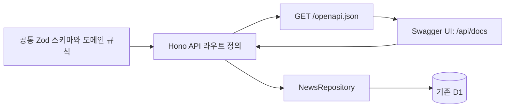

# 1단계 — OpenAPI 명세·Swagger UI 구축 계획

작성일: 2026-10-12 · 상태: 계획 완료 / 구현 전

## 목표와 개발 순서

기존 REST API의 요청·응답 계약을 명세로 제공하고 브라우저에서 직접 조회할 수 있게 한다. 이 단계를 검증한 다음 [MCP 서버 구축 계획](./MCP_SERVER_PLAN.md)을 진행한다. OpenAPI는 MCP의 필수 프로토콜이 아니라 이번 프로젝트에서 공유 계약을 먼저 정리하기 위한 선행 작업이다.

1. 기존 응답과 입력 검증을 공통 스키마로 정리한다.
2. 기존 다섯 API를 OpenAPI에 등록한다.
3. `/openapi.json`과 `/api/docs`를 제공한다.
4. 기존 화면과 API의 호환성을 검증한다.
5. 독립 PR로 정리하고 이후 MCP 개발을 시작한다.

## 현재 코드와 목표

현재 Hono 라우트는 `workers/api/index.ts`, 검색 검증은 `packages/domain/index.ts`의 `querySchema`, 응답 타입은 `packages/domain/types.ts`, D1 조회는 `packages/storage/index.ts`에 있다. Swagger UI·OpenAPI 문서는 없다.

| 경로 | 명세에 포함할 내용 |
| --- | --- |
| `GET /api/health` | DB 연결 확인, 200 status / 503 오류 |
| `GET /api/items` | 검색·필터·커서, 200 FeedResponse / 400 입력·커서 오류 / 503 |
| `GET /api/items/{id}` | ID 조회, 200 NewsItem / 404 / 503 |
| `GET /api/stats` | 동일 검색 조건 집계, 200 FeedStats / 400 / 503 |
| `GET /api/sources/status` | 12개 출처 상태, 200 sources 배열 / 503 |

현재 API는 코드상 공개 읽기 API다. 명세에 존재하지 않는 인증 요구사항을 추가하지 않는다. 문서용 API도 DB나 수집기를 호출하지 않고 명세/HTML만 제공한다.

## 아키텍처와 기술 선택



- 기존 TypeScript·Hono·Zod 4를 유지한다.
- `@hono/zod-openapi`를 우선 검토해 스키마 기반 라우트·명세를 생성한다. 설치 전 현재 Zod/Hono와의 호환 버전을 확인해 lockfile에 고정한다. [Hono Zod OpenAPI 공식 예제](https://hono.dev/examples/zod-openapi)
- Swagger UI는 `@hono/swagger-ui`를 우선 검토한다. OpenAPI 3.1.0을 목표로 생성기와 UI가 함께 처리하는지 확인한다. [Hono Swagger UI 공식 예제](https://hono.dev/examples/swagger-ui)
- 소스 코드의 스키마와 라우트 메타데이터를 명세 원본으로 삼고 수작업 YAML을 별도 유지하지 않는다. 배포 시 내보내는 JSON은 생성 산출물이다.
- 도메인에 HTTP 전용 의존성이 전파되지 않게 OpenAPI 설명·예시·라우트 메타데이터는 API 계층에 둔다.

제안 파일 구조:

```text
packages/contracts/news.ts       # 공통 응답 스키마·추론 타입
workers/api/openapi.ts            # 라우트 계약·명세 설정
workers/api/docs.ts               # Swagger HTML 설정
workers/api/index.ts              # 라우트 조립·기존 핸들러
tests/api-contract.test.ts        # 실제 응답과 계약 검증
tests/e2e/api-docs.spec.ts         # 문서 로딩·Try it out
```

기존 타입를 한 번에 교체하지 않고 공통 응답 스키마와 정합성을 먼저 검증한다. 최종적으로 동일 구조를 두 군데 수동 관리하지 않도록 정리한다.

## 계약 설계에서 유지할 동작

- 입력: `source`, `tag`, `section`, `conference`, `q`, `period`, `limit`, `cursor`, `sort`, `kind`.
- `period`: all/1d/7d, `limit`: 기본18·최대50, `q`: 최대120자. 정확한 enum은 기존 레지스트리에서 가져온다.
- popular는 YouTube/X에서만, tutorial은 YouTube에서만, official은 X에서만 허용한다. JSON Schema로 표현되지 않는 교차 조건은 런타임 검증과 설명·예제로 보존한다.
- 커서는 불투명 값이며 동일 필터·정렬에만 재사용한다. 검색 결과가 비면 200과 빈 배열을 반환한다.
- FeedResponse의 `items`, `nextCursor`, `total`, 항목의 nullable·optional·발견 메타데이터를 실제 타입와 응답에 맞춘다.
- FeedStats의 `topics`는 대표 분야별 집계, `tags`는 다중 태그 빈도다. 목록과 동일한 중복 제거·YouTube 다양성 제한을 적용한다. stats는 커서로 잘린 페이지가 아닌 전체 조건 집계다.
- SourceStatus는 source/status/lastAttemptAt/lastSuccessAt/count/stale을 제공한다. 현재 API에 없는 내부 `error_code`나 실행 로그를 명세에 넣지 않는다.
- 기존 `invalid_query`, `invalid_cursor`, `not_found`, `service_unavailable` 오류와 상태 코드를 유지한다. 라이브러리 기본 검증 오류가 기존 JSON 형식을 바꾸지 않게 훅을 설정한다.

## Swagger 화면과 경로

- 구현 후 로컬: `http://127.0.0.1:8787/api/docs`, `/openapi.json`.
- 구현·배포 후 운영: `https://ai-signal.negroism.workers.dev/api/docs`, `/openapi.json`.
- 현재는 위 문서 경로가 구현되지 않았다. OpenAPI servers는 같은 origin의 `/`를 기본으로 해 로컬에서 운영 DB를 실수로 조회하지 않게 한다.
- `/api/docs`는 `/api/*` 404보다 먼저, `/openapi.json`은 정적 파일 fallback보다 먼저 등록한다.
- 목록·상세·통계·상태별 설명과 예시를 제공하고 Try it out은 기존 GET API를 호출한다.
- UI 정적 자산은 버전을 고정한다. CDN을 사용하면 네트워크 의존성을 명시하고 CSP·secureHeaders와 실제 브라우저 호환성을 확인한다. 문서 로딩 실패 시 self-hosted 자산으로 전환한다.

## 구현·검증 단계

| 순서 | 작업 | 완료 기준 |
| --- | --- | --- |
| A1 | 계약 추출 | 현재 응답 fixture와 nullable/optional/enum 일치 |
| A2 | 명세 생성 | 다섯 경로·고유 operationId·모든 참조 해석, OpenAPI 검증 통과 |
| A3 | 라우트 연결 | 기존 입력·오류·커서·집계 동작 유지 |
| A4 | UI 연결 | 다섯 경로 표시, 실제 Try it out 성공·400·404 확인 |
| A5 | 회귀 검사 | 타입검사·단위/D1·빌드와 관련 브라우저 검사 통과 |
| A6 | 전달 | README 접속 방법, PR 및 배포 후 확인 항목 정리 |

검사는 명세 문자열 비교에 그치지 않고 실제 핸들러의 성공/실패 응답을 스키마와 대조한다. 날짜·null·빈 결과·잘못된 커서·존재하지 않는 ID·DB 장애를 포함한다.

## 배포와 완료 범위

추천 브랜치: `feature/openapi-swagger` (아직 생성하지 않음).

기존 API Worker의 변경으로 배포한다. DB 마이그레이션·Collector Cron·수집 횟수 변경은 필요하지 않다. 운영 반영 후 명세 JSON, Swagger 화면, 기존 웹 목록을 확인한다. 문제가 있으면 API Worker를 이전 버전으로 되돌릴 수 있다.

문서 조회와 Try it out도 요청·DB 사용량을 만들 수 있다. 명세 제공은 DB 조회 없이 처리하고 테스트에서 무제한 자동 호출을 만들지 않는다.

이 단계 완료 후 공통 계약을 재사용해 MCP를 구현한다. 배포 완료 여부와 코드 검증 완료 여부는 구분해 기록한다.

## 구현 결과 — 2026-10-12

1차 로컬 구현 완료. 공통 응답 스키마와 추론 타입, OpenAPIHono 다섯 라우트, `/openapi.json`, `/api/docs`, Vite 프록시 및 Workers 우선 라우팅을 구현했다. UI 설정은 작은 규모라 별도 docs.ts 대신 API 진입점에 둔다. OpenAPI 응답 스키마와 실제 D1 응답 검증, 오류 호환 검사, 브라우저 Try it out을 추가했다. 운영 배포와 MCP 구현은 아직 수행하지 않았다.
